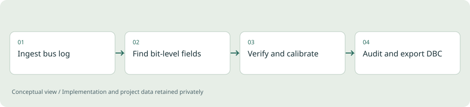

# CANlens

**Automotive data tooling / Personal project**

Turning raw CAN and CAN FD recordings into evidence-graded signal definitions, and checking the DBC a team already relies on.

*Illustrative diagram, not a product screenshot or implementation blueprint.*

## Problem

Vehicle bus recordings arrive in many logger formats, and the DBC meant to explain them is often incomplete, outdated or partly wrong. Reverse engineering by eye is slow, and a guessed scale factor looks just as convincing as a proven one.

## Project scope

A browser tool with a FastAPI backend. It ingests PEAK TRC, candump, BUSMASTER, SavvyCAN, CSV, ASAM MDF 3 and 4, Vector ASC and BLF, and python-can SQLite logs, detecting the format from content rather than the file extension. It analyses timing, CRCs and rolling counters, bit-level field boundaries, byte order and field types; decodes ISO-TP with UDS, OBD-II and J1939 traffic; audits a supplied DBC signal by signal; and exports a merged DBC. Files that already contain decoded physical values switch to a signal-quality mode.

**Technical areas:** Python / FastAPI / NumPy / cantools / asammdf / uPlot

## Engineering decisions

- Grade every conclusion as proven, calibrated, consistent or observed, so a range guess is never presented as a decoded signal.
- Solve CRC-8 algebraically across all 255 polynomials using CRC linearity, verify the result on every frame, and report the odds of a coincidence from the GF(2) rank of the payload variation.
- Use standardised traffic (OBD-II, J1939 and DBC signals that pass validation) as reference series; correlate unknown fields against them and fit scale and offset by least squares.
- Keep the analysis deterministic and usable without any external service; an optional LLM briefing only summarises results.
- Parse every exported DBC with cantools in strict mode before it can be downloaded.

## Outcome

A working analysis tool with a test suite that writes synthetic recordings with known ground truth in every supported format, including CRC-8/AUTOSAR with a counter, Intel and Motorola signals, signed and multiplexed values, OBD-II polling and J1939 groups. The tests check that the engine recovers each one, that all formats load identically, that the audit flags deliberate DBC errors, and that exported DBC files decode identically.

## Limits and context

A single steady operating point shows consistency but cannot prove scale and offset; a sweep or a reference source on the bus is needed. J1939 multi-packet transport is identified but not reassembled, LIN and FlexRay are out of scope, and protected payloads such as SecOC MACs cannot be decoded. Accuracy on real vehicle recordings has not been independently validated.

[Back to portfolio](../README.md)
