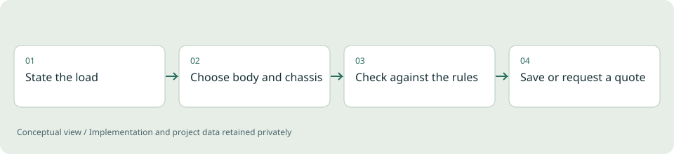

# Coldfit

**Configurator / Personal concept**

A configurator for refrigerated vehicles that checks a choice against the load and the rules before it asks for a quotation.

*Illustrative diagram, not a product screenshot or implementation blueprint.*

## Problem

Buyers of refrigerated vehicles usually pick a body size first and find out later that the pallets do not fit, the payload is too low, the chassis is not offered in that weight class or a different licence applies. A configurator that only lists options leaves that checking to a sales conversation.

## Project scope

A bilingual web configurator. The user states the load (pallets and payload), then chooses temperature class, body size, chassis, powertrain and equipment. A fit check updates live: pallet positions, a likely payload band, external width and height against legal limits, licence and tachograph notes, ATP class and chassis compatibility. Failed checks offer a one-click fix. The user can save and share a configuration, print a specification or send a quotation request. A quotation request opens a private conversation between the customer and the sales team at once. A sales side turns the request into a priced, versioned offer on that same page, with a PDF, a live chat, changes the customer can make to the vehicle themselves, and payment requests, and tracks it to a decision.

**Technical areas:** Next.js / React / TypeScript / Cloudflare D1 / Drizzle / PDF generation / Stripe / Docker

## Engineering decisions

- Keep the rules engine a set of pure functions over a typed catalog, so every check is unit-tested without a browser or a database.
- Label every fact as published (law or standard), typical (public manufacturer information) or estimate, and show payload and dimensions as ranges, never as single exact numbers.
- Combine independent component-mass uncertainties as a root of summed squares to give a likely band rather than a worst case.
- Pack pallets with a two-block guillotine search and test it against hand-counted layouts and monotonicity.
- Version the configuration schema and upgrade old saved links on read, so earlier shared configurations keep working.
- Protect the quotation form with a hidden field, a timing check, per-address rate limiting on a salted hash that is cleared after 24 hours, explicit consent and no third-party scripts.
- Disable the staff area until a long master secret is set, compare it in constant time, then add staff by single-use invitation links with hashed passwords, roles and server-side checks on every request.
- Freeze an offer's prices when it is built, record every later edit as a new version with a field-level difference, and never alter a version the customer has already seen.
- Keep a price list with a full change log, and list the open offers that a price change affects instead of silently changing them.
- Track offer status automatically where the system can observe it (opened, accepted, change requested, expired) and by hand where it cannot, marking each step as one or the other.
- Open a conversation the moment a request arrives: the sender is saved as a customer, any salesperson can pick it up, the first to act becomes its owner, and the later offer appears on the same private page.
- Let the customer rebuild the vehicle in the full configurator. Before an offer exists the change is applied directly; after one was sent it becomes a proposal with its differences that staff apply as a new version or decline.
- Refresh every open screen from a small change stamp polled every three seconds, so messages and status arrive almost at once without socket infrastructure, and never overwrite unsaved edits.
- Mark a payment as paid only from a staff confirmation or from a provider notification whose signature, timestamp and exact amount all check out, and treat repeated notifications as harmless.
- Write the offer PDF with a small dependency-free generator, and keep email, CRM, payment and assistant integrations as adapters that stay off until configured.
- Ship the release pre-built and install only the runtime on the target machine, with file names and database paths kept short enough for Windows.

## Outcome

A working application with 36 unit tests, 226 API checks and two browser flows (75 checks), verified in German and English from 360 to 1440 px, started by one launcher on Windows, macOS and Linux. A hosted deployment, a full run on a clean Windows machine and the live email, CRM, payment and assistant connections have not been run.

## Limits and context

The catalog and price structure are a planning model, not supplier data: chassis weight classes are rounded from public information and payload and dimensions are estimates. Nothing in it is an offer, an approval or a certification. The legal text describes what the application does and has not been reviewed by a lawyer. Implementation and any manufacturer reference remain private.

[Back to portfolio](../README.md)
