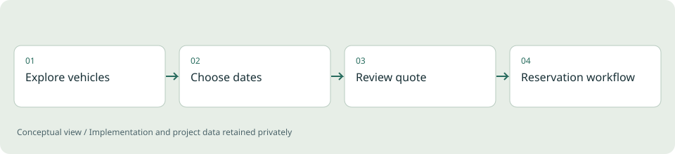

# Motorhome Booking Platform

**Full-stack engineering / Demonstration application**

A booking workflow that connects a customer-facing experience with availability and reservation rules.

*Illustrative diagram, not a product screenshot or implementation blueprint.*

## Problem

A booking interface has to explain availability clearly while keeping dates, quotes and reservation states consistent. An attractive page alone does not solve those operational rules.

## Project scope

The application brings together server-rendered pages, quote calculation, availability checks and persistent booking records, extended with an owner-facing dashboard, in-app booking messaging with attachments, and integrations for deposit payments and transactional email. Later releases added an owner availability calendar that imports an external rental marketplace calendar, same-day turnaround, optional authenticator-app sign-in for the owner and administrator, malware scanning of uploaded attachments, runtime backups and layered enquiry spam protection. Its demo configuration separates the visible experience from real business contacts, payment credentials and customer information.

**Technical areas:** Node.js / JavaScript / SQLite / HTML & CSS / iCal / third-party payment and email APIs

## Engineering decisions

- Model dates and booking states explicitly.
- Include turnaround time in the operational concept of availability.
- Keep business rules separate from the presentation so changes can be reasoned about.
- Separate customer-facing and owner-facing views behind their own authentication checks.
- Treat payment and email providers as replaceable integrations rather than hard-coded services.
- Import the external calendar on a schedule and key the owner's release decisions to event IDs, so a refresh or restart never silently re-blocks dates.
- Reject spam before anything is stored or emailed, using an invisible bot trap, a sales-pitch content filter, a per-IP limit and duplicate suppression.
- Offer optional time-based one-time codes for owner and administrator sign-in, with session expiry and fresh sign-in before changes after inactivity.

## Outcome

A complete demonstration of a booking-oriented web application, including the logic behind the customer journey, an owner dashboard for managing reservations, the messaging and payment integrations a live deployment would need, and the calendar and security controls added since. 119 automated tests cover the booking flow, payment totals, calendar import, owner access and spam handling. No revenue or customer-adoption claim is made.

## Limits and context

Live operation requires its own integration and concurrency validation, business configuration and deployment checks. The calendar import runs hourly rather than in real time, and the spam controls reduce unwanted enquiries without guaranteeing that every one is blocked.

[Back to portfolio](../README.md)
