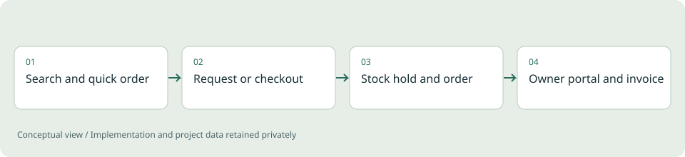

# Partsline

**Full-stack / Commerce demonstration**

A parts webshop with an owner portal, where stock stays correct from the first search to the last invoice.

*Illustrative diagram, not a product screenshot or implementation blueprint.*

## Problem

A spare-parts shop has to show what is really in stock, hold it while a customer decides, and keep orders, mail and invoices consistent. A catalog page alone does not do that, and a wrong stock number costs a customer trust.

## Project scope

A bilingual commerce application for vehicle-body parts. Customers search by part number, name or category, paste a list of article numbers for a quick order, save parts, and either send a non-binding request or check out. The owner workspace covers products, variants, prices, photos, stock, incoming requests, orders, returns, a shared customer inbox and team logins. Stock and parts can be imported in bulk from Excel, CSV or a PDF table, with a catalog-grounded assistant to help find parts.

**Technical areas:** Python / FastAPI / SQLAlchemy / SQLite / PostgreSQL / Stripe / Docker

## Engineering decisions

- Hold stock transactionally with an expiry and recheck price and availability at the order boundary, so a basket never promises what the shelf cannot deliver.
- Make request submission idempotent and give customers a private reference and access code instead of an account.
- Import stock with a dry-run preview of every change and row error, then apply it in one transaction with a backup taken first.
- Treat payment, mail and ERP connections as adapters: hosted card checkout with signed webhooks, SMTP, IMAP, Microsoft 365 and Google Workspace mail, and a signed event outbox.
- Keep the assistant grounded in the real catalog, so it never invents a compatibility match.
- Record every owner change in an audit trail, and provide privacy export and anonymisation.
- Run locally with SQLite and one launcher, and with PostgreSQL under Docker Compose from the same code.

## Outcome

A complete demonstration of a parts-commerce application: catalog, quick order, requests, checkout, stock holds, invoices, returns, inbox and scheduled backups. 171 automated backend tests cover stock, orders, import, mail, security and the owner workflows. No revenue or customer-adoption claim is made.

## Limits and context

Live operation needs real accounts for payments and mail, approved product data and legal text, and acceptance testing against those providers. The tests ran on SQLite; PostgreSQL, Docker and the live integrations were not exercised. Scope is one country, one currency, one warehouse and whole-number quantities.

[Back to portfolio](../README.md)
