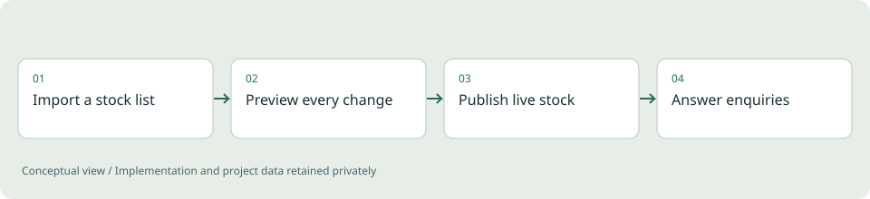

# Stockline

**Full-stack / Inventory demonstration**

A parts website with live stock and enquiries, where the owner keeps stock current from a spreadsheet.

*Illustrative diagram, not a product screenshot or implementation blueprint.*

## Problem

Many small parts businesses keep stock in a spreadsheet. Getting that list onto a website without breaking the catalog is the hard part, and so is answering a customer who sends a whole list of parts at once.

## Project scope

A lighter edition built from the same code base as the full parts shop. Customers search parts, see live stock, check a pasted parts list against stock and send an enquiry for one part or a whole list. The owner imports stock and parts from Excel (with pictures), CSV, TSV or a PDF table, maps their own column titles, receives deliveries, adjusts stock with a full history, and answers enquiries in the portal and by email. Orders, payments and shipping are switched off and answer 404.

**Technical areas:** Python / FastAPI / SQLAlchemy / SQLite / PostgreSQL / Docker

## Engineering decisions

- Build both editions from one code base with a flag, and verify each build, so the lighter product never drifts from the full one.
- Recognise German and English column titles, let the owner re-map every field, and process up to 20,000 rows.
- Show a dry run first, then re-check and apply everything in a single transaction.
- Give customers a private reference and access code for replies, so they can read answers even before a mailbox is connected.
- Offer clear, confirmed tools to set all stock to zero or clear the catalog, with a backup taken first.
- Keep the owner portal behind a master login with optional staff logins, and audit every change.

## Outcome

A working inventory-and-enquiry website: import, preview, live stock, enquiries and replies, with English and German and light and dark themes. 47 automated backend tests cover import, stock, enquiries and security. No revenue or customer-adoption claim is made.

## Limits and context

The sample catalog uses dummy quantities and must be replaced with real data. Mail needs a configured mailbox, and the tests ran on SQLite only; PostgreSQL, Docker and the Windows launcher were not run in the verification.

[Back to portfolio](../README.md)
